# 🏷️ Portfólio Profissional — Rafael Abi-Saber Cardoso 👨‍💻

> Website de portfólio profissional bilíngue (PT/EN), com apresentação, linha do tempo de projetos, experiências e formulário de contato com envio por e-mail. Desenvolvido no **LAB01 da disciplina Desenvolvimento e Integração de Aplicações Web (DIAW)**, do curso de Engenharia de Software da PUC Minas.

<p align="center">
  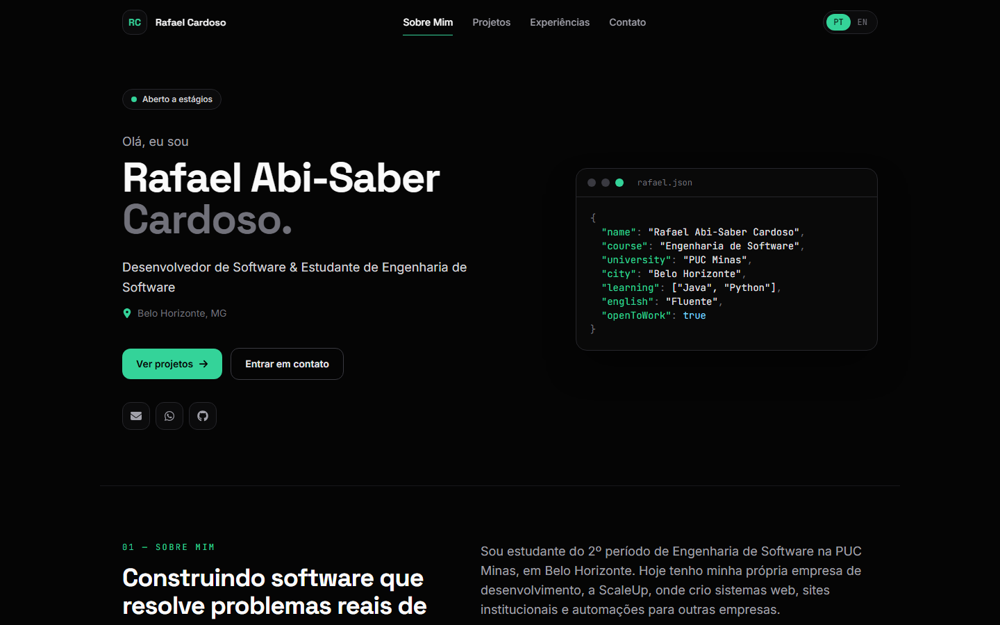
</p>

---

## 🚧 Status do Projeto


---

## 📚 Índice

- [🔗 Links Úteis](#-links-úteis)
- [📝 Sobre o Projeto](#-sobre-o-projeto)
- [✨ Funcionalidades Principais](#-funcionalidades-principais)
- [🛠 Tecnologias Utilizadas](#-tecnologias-utilizadas)
- [🏗 Arquitetura](#-arquitetura)
- [🎨 Protótipos (Wireframes)](#-protótipos-wireframes)
- [🔧 Instalação e Execução](#-instalação-e-execução)
- [🚀 Deploy](#-deploy)
- [📂 Estrutura de Pastas](#-estrutura-de-pastas)
- [🎥 Demonstração](#-demonstração)
- [🧪 Testes](#-testes)
- [🔗 Documentações utilizadas](#-documentações-utilizadas)
- [👥 Autores](#-autores)
- [🤝 Contribuição](#-contribuição)
- [🙏 Agradecimentos](#-agradecimentos)
- [📄 Licença](#-licença)

---

## 🔗 Links Úteis

- 🌐 **Site publicado (Vercel):** [rafael-cardoso-portfolio.vercel.app](https://rafael-cardoso-portfolio.vercel.app)
- 💻 **Repositório:** [github.com/RafaelCardoso25/portifolio](https://github.com/RafaelCardoso25/portifolio)
- 🎨 **Wireframes:** pasta [`docs/wireframes`](docs/wireframes)
- 📸 **Capturas de tela:** pasta [`docs/screenshots`](docs/screenshots)

---

## 📝 Sobre o Projeto

O objetivo é apresentar minha trajetória, habilidades, projetos e formas de contato de maneira moderna e acessível, seguindo a descrição do Product Owner do LAB01.

O site tem quatro páginas, acessadas pelo menu de navegação:

1. **Sobre Mim:** apresentação em português e inglês, com formação, área de atuação, interesses, objetivos e tecnologias.
2. **Projetos:** linha do tempo do projeto mais antigo ao mais recente. Cada projeto tem nome, descrição, tecnologias, link para o GitHub e um GIF do projeto em funcionamento.
3. **Experiências:** experiência profissional, formação e intercâmbio, cada uma com instituição, cargo/atividade, período e descrição.
4. **Contato:** ícones clicáveis (e-mail, WhatsApp e GitHub) e formulário com nome, e-mail e mensagem, enviado por e-mail.

**Identidade visual:** tema escuro com base preta (`#050505`), tons de cinza e verde-esmeralda (`#34D399`) como cor de destaque. A tipografia combina *Space Grotesk* (títulos), *Inter* (texto) e *JetBrains Mono* (detalhes técnicos), para um visual limpo, profissional e ligado à área de desenvolvimento.

---

## ✨ Funcionalidades Principais

- 🌎 **Bilíngue (PT/EN):** botão no cabeçalho que traduz o site inteiro, com o idioma escolhido salvo no navegador.
- 🕒 **Timeline dinâmica de projetos:** gerada a partir de `src/data/projects.js`, com filtro por tecnologia, ordenação (mais antigo ↔ mais recente) e animações de entrada.
- 🎞️ **GIFs dos projetos** em funcionamento (telas de login, painéis e fluxos).
- 💼 **Experiências organizadas** por tipo (profissional, formação e intercâmbio), com período e tags.
- ✉️ **Formulário de contato funcional** com envio de e-mail pelo **EmailJS** (e um serviço reserva, o FormSubmit, caso as chaves não estejam configuradas).
- ✅ **Validações:** campos obrigatórios, tamanho mínimo, formato de e-mail, mensagens de erro acessíveis e proteção *honeypot* contra spam.
- 📱 **Design responsivo** (mobile, tablet e desktop), com menu hambúrguer no celular.
- ♿ **Acessibilidade:** HTML semântico, `aria-label`, foco visível e respeito a `prefers-reduced-motion`.
- 🔀 **Rotas SPA** com React Router (`/`, `/projetos`, `/experiencias`, `/contato`) e página 404.

---

## 🛠 Tecnologias Utilizadas

### 💻 Front-end

| Tecnologia | Versão | Uso |
|---|---|---|
| [React](https://react.dev/) | 19 | Biblioteca de interface |
| [Vite](https://vite.dev/) | 8 | Build e servidor de desenvolvimento |
| [React Router DOM](https://reactrouter.com/) | 7 | Navegação entre páginas |
| [Tailwind CSS](https://tailwindcss.com/) | 3 | Estilização utilitária e responsividade |
| [Framer Motion](https://www.framer.com/motion/) | 14 | Animações e transições |
| [React Icons](https://react-icons.github.io/react-icons/) | 5 | Ícones (redes sociais e tecnologias) |
| [EmailJS](https://www.emailjs.com/) (`@emailjs/browser`) | 5 | Envio de e-mail direto do front-end |

### 🖥️ Back-end

Não há back-end próprio: o site é estático (SPA). O envio de e-mail é feito pelo serviço **EmailJS**, chamado do navegador.

### ⚙️ Infraestrutura & DevOps

| Ferramenta | Uso |
|---|---|
| [Vercel](https://vercel.com/) | Hospedagem gratuita e deploy contínuo a partir do GitHub |
| [GitHub](https://github.com/) | Versionamento do código |
| [Oxlint](https://oxc.rs/) | Linter de JavaScript/React |
| PostCSS + Autoprefixer | Processamento do CSS |

### 📦 Dependências

**Dependências de produção** (`dependencies`):

```
@emailjs/browser   framer-motion   react   react-dom   react-icons   react-router-dom
```

**Dependências de desenvolvimento** (`devDependencies`):

```
@vitejs/plugin-react   vite   tailwindcss   postcss   autoprefixer   oxlint   @types/react   @types/react-dom
```

---

## 🏗 Arquitetura

SPA (Single Page Application) com componentes React organizados em camadas simples:

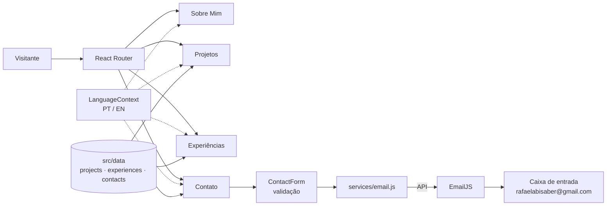

- **`pages/`:** uma página por rota.
- **`components/`:** partes reutilizáveis (Navbar, Footer, ProjectCard, ContactForm, Reveal…).
- **`data/`:** o conteúdo (projetos, experiências e contatos) fica separado do layout. Para adicionar um projeto à timeline, basta incluir um objeto em `projects.js`.
- **`i18n/`:** contexto de idioma e todos os textos da interface em PT e EN.
- **`services/`:** integração com o serviço de e-mail.

**Por que essas escolhas?** React + Vite deixam o desenvolvimento rápido e o build leve. O Tailwind facilita manter a identidade visual e a responsividade. Separar os dados do layout deixa a timeline "dinâmica". O EmailJS permite enviar e-mails sem manter um servidor.

---

## 🎨 Protótipos (Wireframes)

Wireframes de média fidelidade feitos antes da implementação (Sprint 01):

| Sobre Mim | Projetos (timeline) |
|---|---|
| 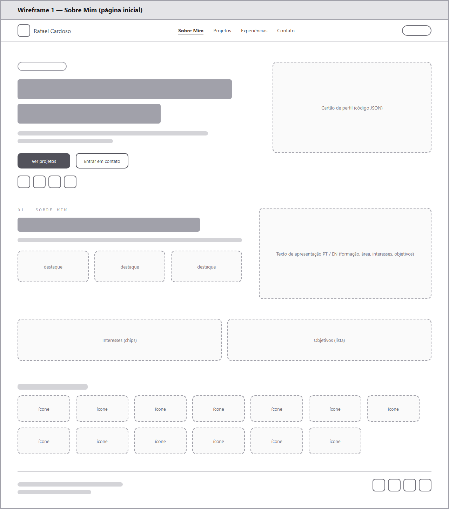 | 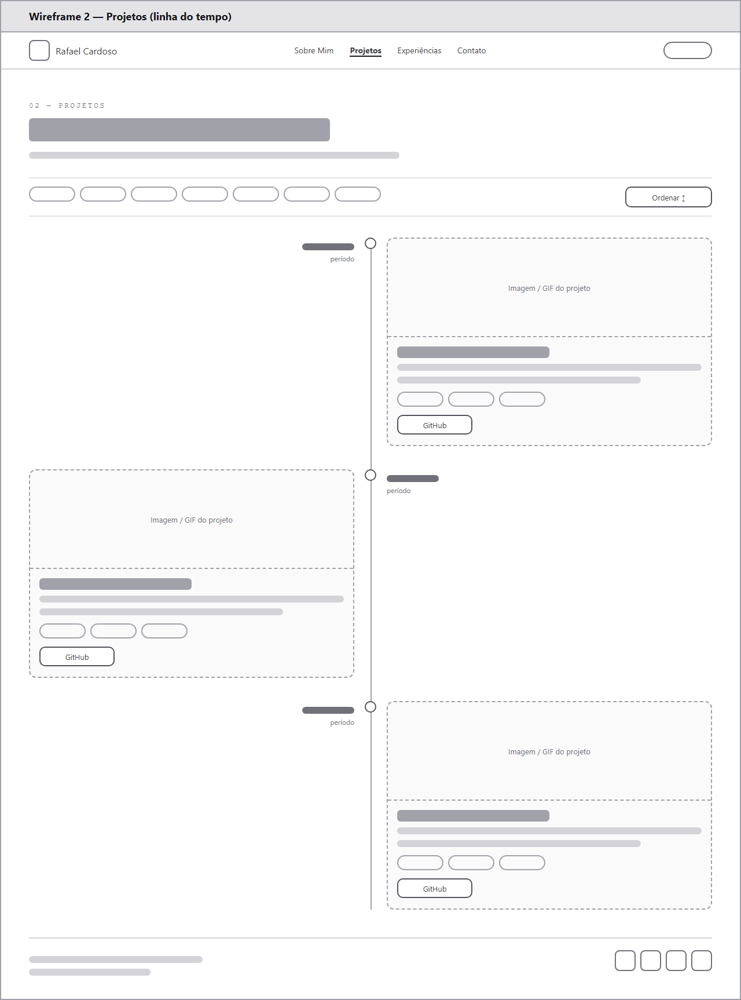 |

| Experiências | Contato |
|---|---|
| 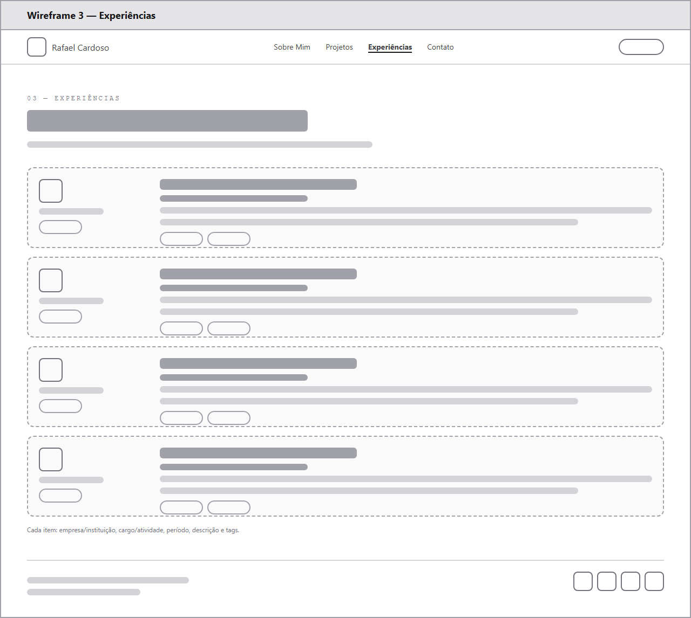 | 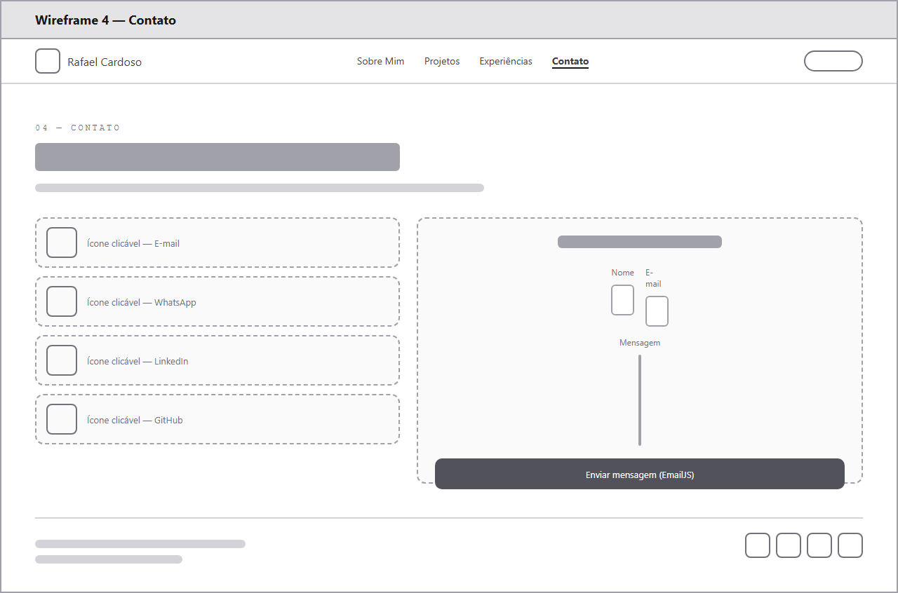 |

**Versão mobile:**

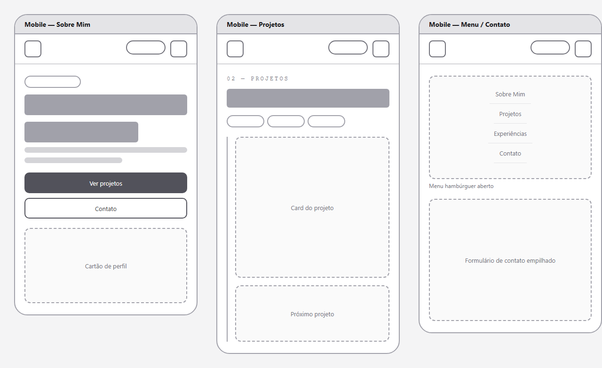

---

## 🔧 Instalação e Execução

### Pré-requisitos

- [Node.js](https://nodejs.org/) **18 ou superior** (desenvolvido com Node 24)
- npm (vem junto com o Node)
- Git

### 🔑 Variáveis de Ambiente

Copie o arquivo de exemplo e preencha com as chaves do EmailJS:

```bash
cp .env.example .env
```

| Variável | Descrição | Onde encontrar |
|---|---|---|
| `VITE_EMAILJS_SERVICE_ID` | ID do serviço de e-mail | EmailJS → Email Services |
| `VITE_EMAILJS_TEMPLATE_ID` | ID do template da mensagem | EmailJS → Email Templates |
| `VITE_EMAILJS_PUBLIC_KEY` | Chave pública da conta | EmailJS → Account → General |

O template do EmailJS deve usar as variáveis `{{from_name}}`, `{{from_email}}`, `{{reply_to}}` e `{{message}}`.

> Se as variáveis não forem configuradas, o formulário usa o FormSubmit como reserva. No primeiro envio, o FormSubmit manda um e-mail de ativação para o endereço de destino.

### 📦 Instalação de Dependências

```bash
git clone https://github.com/RafaelCardoso25/portifolio.git
cd portifolio
npm install
```

### ⚡ Como Executar a Aplicação

```bash
npm run dev
```

Acesse **http://localhost:5173**.

Outros scripts:

| Comando | O que faz |
|---|---|
| `npm run dev` | Servidor de desenvolvimento com hot reload |
| `npm run build` | Gera a versão de produção na pasta `dist/` |
| `npm run preview` | Abre localmente a versão de produção |
| `npm run lint` | Verifica o código com o Oxlint |

---

## 🚀 Deploy

O site está hospedado gratuitamente na **Vercel**:

1. Criar um projeto na Vercel e importar o repositório do GitHub.
2. Framework preset: **Vite** · Build command: `npm run build` · Output: `dist`.
3. Em *Settings → Environment Variables*, cadastrar as três variáveis `VITE_EMAILJS_*`.
4. Cada `git push` na branch `main` gera um novo deploy automaticamente.

O arquivo `vercel.json` redireciona todas as rotas para o `index.html`, para que links diretos como `/projetos` funcionem.

Pela linha de comando:

```bash
npm i -g vercel
vercel --prod
```

---

## 📂 Estrutura de Pastas

```
portifolio/
├── docs/
│   ├── screenshots/          # Capturas do site (desktop e mobile)
│   └── wireframes/           # Protótipos de média fidelidade
├── public/
│   ├── favicon.svg
│   ├── profile.jpg           # Foto de perfil
│   └── projects/             # GIFs dos projetos exibidos na timeline
├── src/
│   ├── components/
│   │   ├── ContactForm.jsx   # Formulário com validação e envio
│   │   ├── Footer.jsx
│   │   ├── Layout.jsx        # Estrutura base: cabeçalho, conteúdo e rodapé
│   │   ├── Navbar.jsx        # Menu, seletor PT/EN e menu mobile
│   │   ├── PageHeader.jsx
│   │   ├── ProjectCard.jsx   # Item da timeline de projetos
│   │   ├── Reveal.jsx        # Animação de entrada ao rolar
│   │   └── SocialLinks.jsx
│   ├── data/
│   │   ├── contacts.js
│   │   ├── experiences.js
│   │   └── projects.js
│   ├── i18n/
│   │   ├── LanguageContext.jsx
│   │   └── translations.js   # Textos em português e inglês
│   ├── pages/
│   │   ├── About.jsx         # Sobre Mim (página inicial)
│   │   ├── Contact.jsx
│   │   ├── Experiences.jsx
│   │   ├── NotFound.jsx
│   │   └── Projects.jsx
│   ├── services/
│   │   └── email.js          # Integração com EmailJS
│   ├── App.jsx               # Rotas
│   ├── index.css             # Tailwind e estilos globais
│   └── main.jsx
├── .env.example
├── index.html
├── package.json
├── postcss.config.js
├── tailwind.config.js
├── vercel.json
└── vite.config.js
```

---

## 🎥 Demonstração

### 🌐 Aplicação Web

**Sobre Mim (PT e EN)**

| Português | English |
|---|---|
|  | 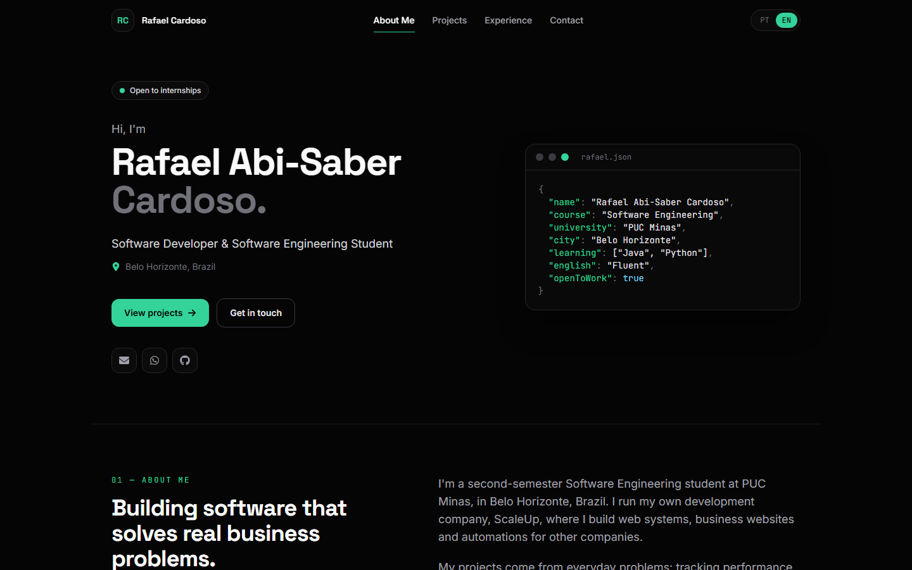 |

**Projetos (timeline) e Experiências**

| Projetos | Experiências |
|---|---|
| 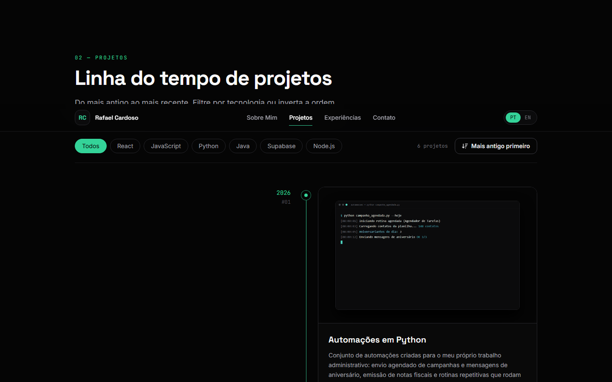 | 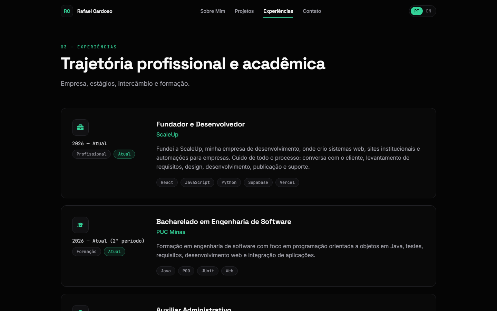 |

**Contato e validação do formulário**

| Contato | Validação |
|---|---|
| 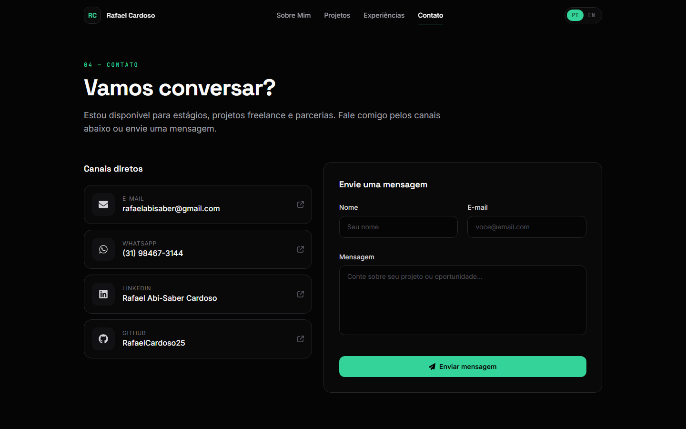 | 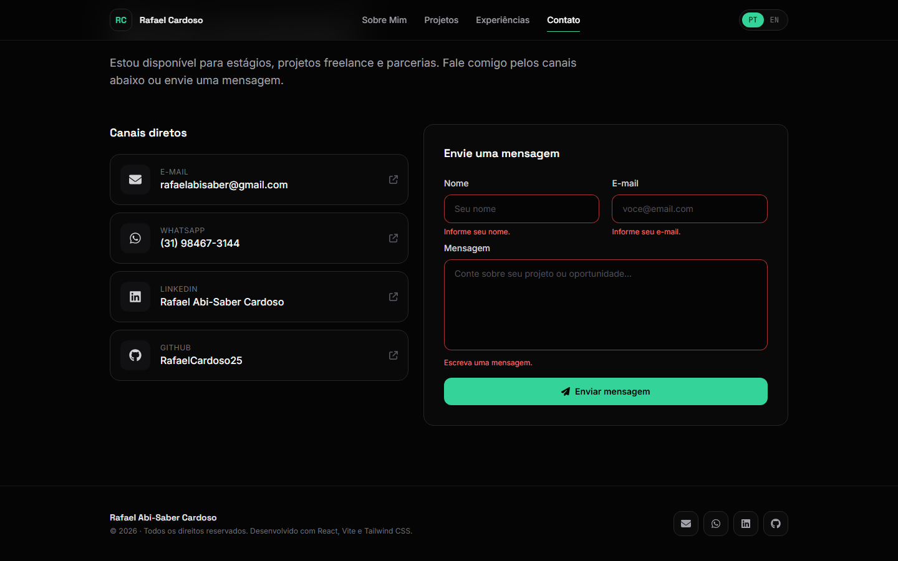 |

### 📱 Responsividade

| Sobre Mim | Projetos | Contato |
|---|---|---|
| 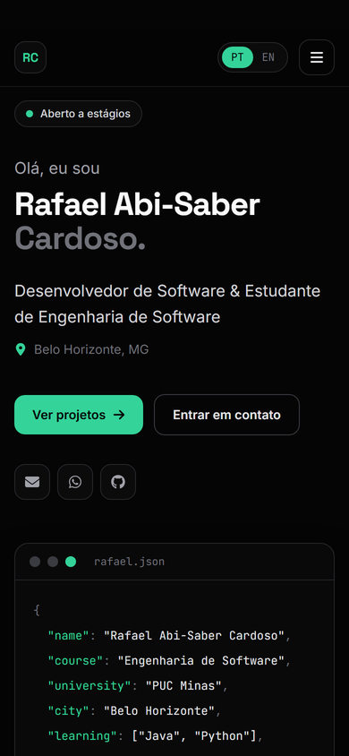 | 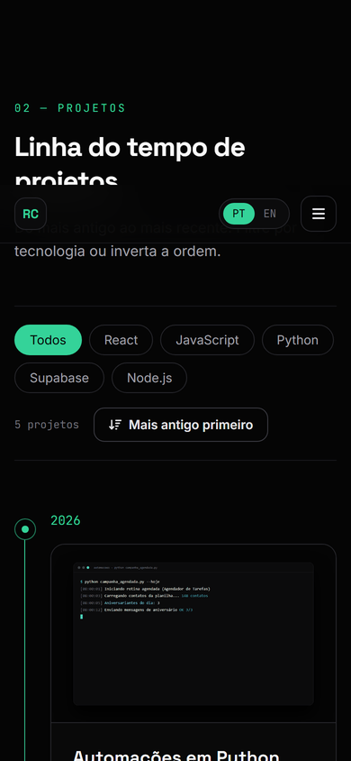 | 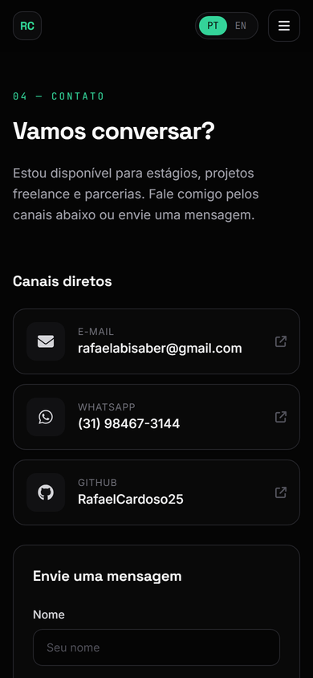 |

### 🎞️ Projetos em funcionamento

| Metrik | Sistema de Despesas |
|---|---|
| 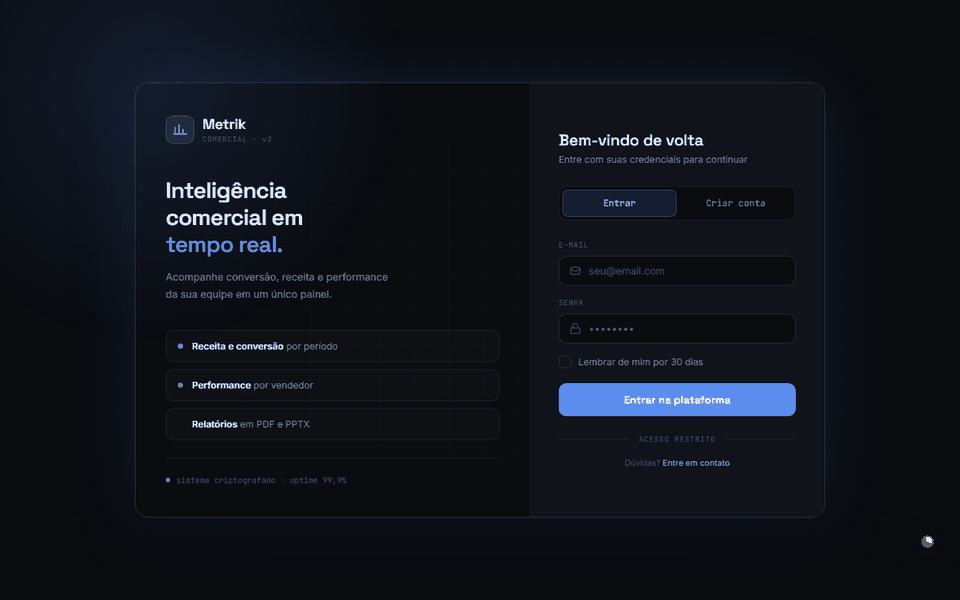 | 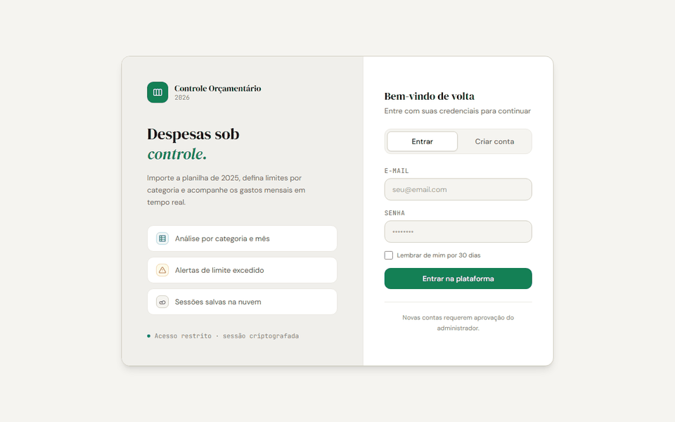 |

| CotaCompara | Automações em Python |
|---|---|
| 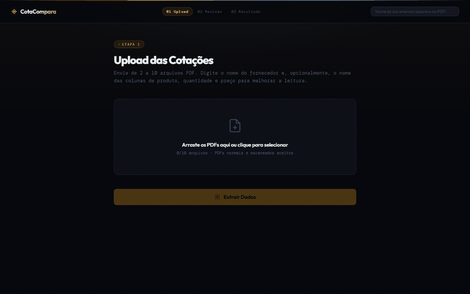 | 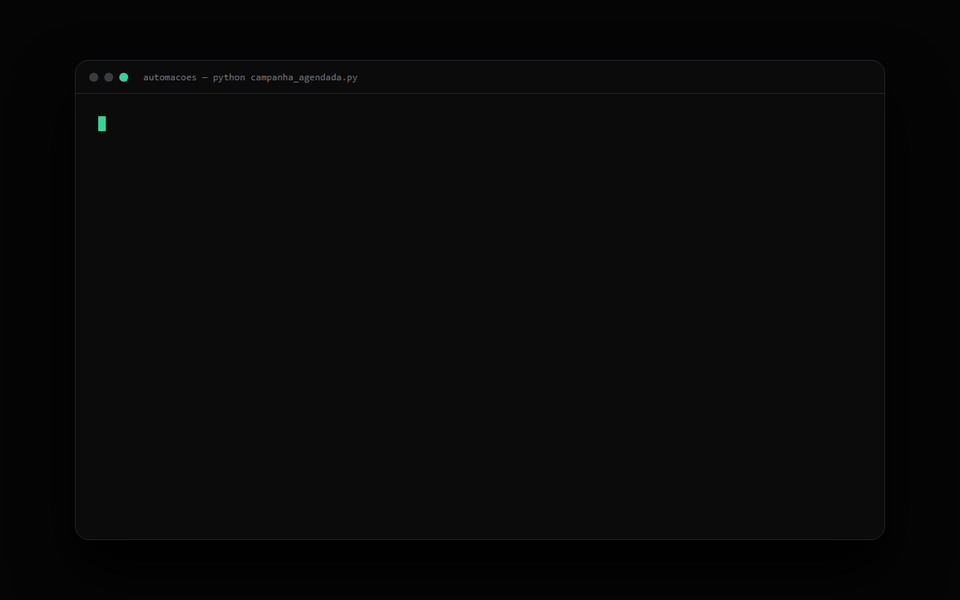 |

---

## 🧪 Testes

- **Lint:** `npm run lint` (Oxlint) sem erros.
- **Build:** `npm run build` gera a versão de produção sem avisos.
- **Testes manuais:** navegação entre todas as rotas, troca de idioma, filtro e ordenação da timeline, validação de cada campo do formulário, envio de e-mail e layout em 390px (mobile), 768px (tablet) e 1440px (desktop), sem rolagem horizontal.

---

## 🔗 Documentações utilizadas

- [React](https://react.dev/)
- [Vite](https://vite.dev/guide/)
- [React Router](https://reactrouter.com/)
- [Tailwind CSS](https://tailwindcss.com/docs)
- [Framer Motion](https://www.framer.com/motion/)
- [EmailJS](https://www.emailjs.com/docs/)
- [Vercel](https://vercel.com/docs)
- [Template de README — Prof. João Paulo Aramuni](https://github.com/joaopauloaramuni/desenvolvimento-e-integracao-de-aplicacoes-web/blob/main/TEMPLATES/template_README.md)

---

## 👥 Autores

| Foto | Nome | Contato |
|---|---|---|
|  | **Rafael Abi-Saber Cardoso** | [GitHub](https://github.com/RafaelCardoso25) · [E-mail](mailto:rafaelabisaber@gmail.com) |

---

## 🤝 Contribuição

1. Faça um fork do projeto.
2. Crie uma branch: `git checkout -b feat/minha-melhoria`.
3. Faça commits seguindo o padrão [Conventional Commits](https://www.conventionalcommits.org/pt-br/), por exemplo `feat: adiciona novo projeto na timeline`.
4. Envie a branch: `git push origin feat/minha-melhoria`.
5. Abra um Pull Request.

---

## 🙏 Agradecimentos

- Prof. **João Paulo Carneiro Aramuni**, pela proposta do laboratório e pelo template de README.
- **PUC Minas**, curso de Engenharia de Software.
- Portfólios usados como referência: Flávio Júnior, Gabriel Victor, Pedro Braga e Luca Azalim.

---

## 📄 Licença

Distribuído sob a licença **MIT**. Veja o arquivo [LICENSE](LICENSE).
